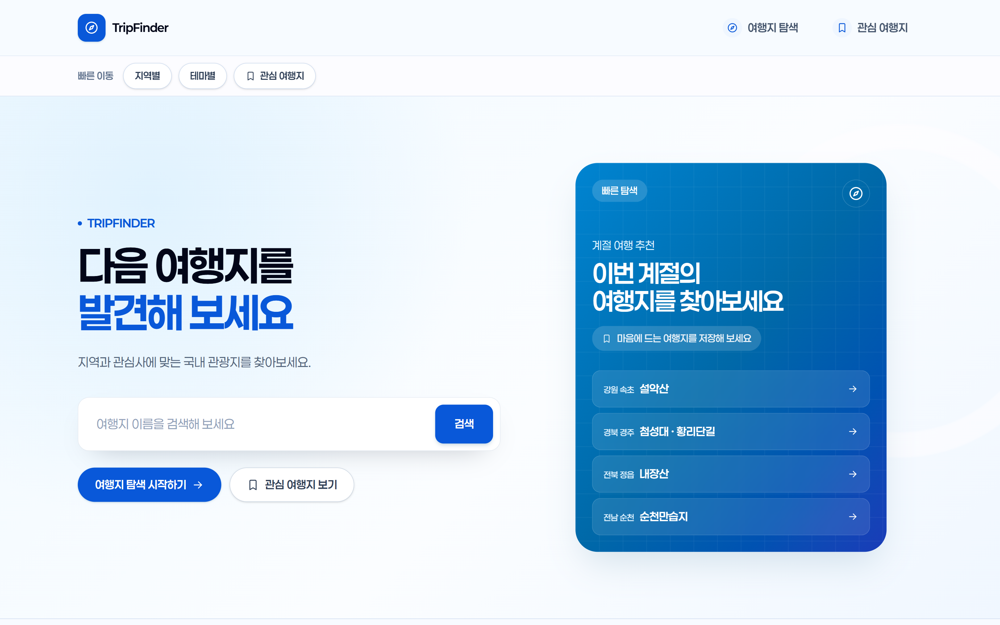
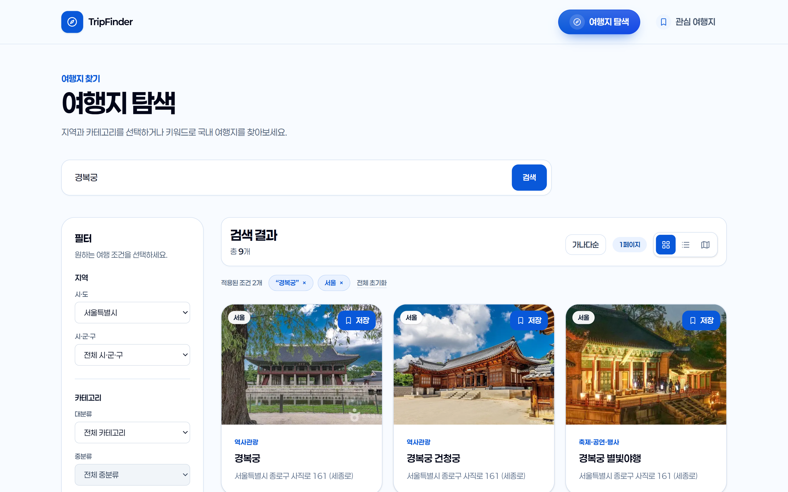
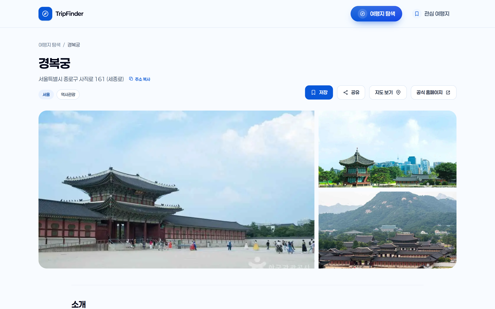

# TripFinder

[](https://github.com/minjuko/trip-finder/actions/workflows/ci.yml)

공공 관광 데이터를 바탕으로 국내 여행지를 검색하고, 상세 정보를 확인하고, 관심 장소를 저장하는 반응형 웹서비스입니다.

- 서비스 주소: https://trip-finder-mauve.vercel.app/
- 포트폴리오: https://app.notion.com/p/3e2622cea8638106bf2ce92c1a25543e
- 기술 문서: https://app.notion.com/p/3e2622cea863810581c9dc081a76bcdf

## 주요 기능과 화면

<table>
  <tr>
    <td width="50%" valign="top">
      
      <br />
      <sub>홈 — 키워드 검색과 빠른 탐색으로 여행지를 찾습니다.</sub>
    </td>
    <td width="50%" valign="top">
      
      <br />
      <sub>탐색 — 지역·분류·키워드·정렬·이미지 조건으로 결과를 좁힙니다.</sub>
    </td>
  </tr>
  <tr>
    <td width="50%" valign="top">
      
      <br />
      <sub>상세 — 여행지 정보와 이미지, 지도·공식 홈페이지 이동을 확인합니다.</sub>
    </td>
    <td width="50%" valign="top">
      
      <br />
      <sub>관심 여행지 — 브라우저에 저장한 장소를 다시 확인하고 관리합니다.</sub>
    </td>
  </tr>
</table>

- 지역·관광 분류·키워드 검색과 카드, 목록, 지도 보기
- 제목순·수정일순·생성일순 정렬 및 대표 이미지가 있는 장소 필터
- 검색 조건을 URL에 보존해 링크 공유와 새로고침 후 상태 복원
- 상세 정보, 이미지 확대, 주소 복사, 공유 및 지도 연결
- localStorage 기반 관심 장소 저장·삭제

## 핵심 기술 스택

| 구분        | 기술                                                                           |
| ----------- | ------------------------------------------------------------------------------ |
| 화면        | Next.js 16.4.2 App Router, React 19.2.8, TypeScript 5 (strict), Tailwind CSS 4 |
| 데이터·지도 | 한국관광공사 TourAPI, Zod 4, Leaflet, OpenStreetMap                            |
| 검증        | Vitest, React Testing Library, Playwright, axe-core, GitHub Actions            |

## 구현한 기술적 의사결정

- 서버 렌더링 화면과 검색·필터·저장처럼 상호작용이 필요한 클라이언트 화면을 나눴습니다.
- TourAPI 응답을 검증·정규화해 외부 응답 형식과 화면에서 쓰는 데이터를 분리했습니다.
- 검색 조건을 URL로 관리하고 TourAPI 정렬 조건에 연결해 직접 접근과 새로고침에서도 조건을 복원합니다.
- 인증·호출 제한·서버 오류를 구분하고 데이터 성격에 맞춰 캐시와 재검증 정책을 적용합니다.

## 문제 해결과 검증 결과

TourAPI 상세 응답에서 하위 항목 식별자가 누락되거나 빈 목록의 형식이 달라지는 사례를 정규화 계층에서 처리하고 회귀 테스트로 보강했습니다.

[GitHub Actions CI #65](https://github.com/minjuko/trip-finder/actions/runs/40282569373)은 기준 커밋 `563be3960cdaad66efadfc2cc1a82cc8b915b2a3`에서 성공했습니다. 당시 Vitest 32개 파일·166개 테스트, Playwright E2E 20개가 통과했으며 format, lint, typecheck, coverage, fixture production build도 실행됐습니다. CI는 실제 TourAPI 대신 고정 fixture와 더미 서비스 키를 사용하므로 운영 API 연동을 검증하지 않습니다.

성능 자료는 서로 다른 실험을 구분해 보존했습니다. 과거 Lighthouse 실험에서는 LCP와 전송량이 낮아졌지만 TBT는 악화됐습니다. TF07의 Performance API fixture 측정은 Lighthouse 결과가 아니며, TF08은 합성 로컬 이미지로 Next.js 변환 경로를 확인한 방법 기록입니다. 실제 관광지 사진이나 운영 네트워크의 성능 개선을 입증하지 않습니다.

## 로컬 실행과 검사

일반 실행에는 `.env.local`에 발급받은 `TOUR_API_SERVICE_KEY`가 필요합니다. 키를 저장소에 커밋하지 마세요.

```dotenv
TOUR_API_SERVICE_KEY=your_service_key
```

```bash
npm ci
npm run dev
```

| 명령                    | 설명                     |
| ----------------------- | ------------------------ |
| `npm run format:check`  | Prettier 형식 검사       |
| `npm run lint`          | ESLint 검사              |
| `npm run typecheck`     | TypeScript 검사          |
| `npm run test:coverage` | Vitest 및 coverage       |
| `npm run test:e2e`      | Playwright E2E           |
| `npm run build`         | Next.js production build |

GitHub Actions와 E2E는 fixture 모드 및 더미 서비스 키를 사용합니다. 따라서 CI 검증에 실제 TourAPI 키가 필요하지 않습니다.

## 관련 기술문서

- [모바일·접근성 감사](docs/mobile-accessibility-audit-2026.md)
- [Explore Lighthouse 과거 실험 기록](docs/explore-performance-audit-2026.md)
- [TF08 로컬 이미지 fixture 측정 방법](docs/tf08-local-image-performance-fixture.md)
