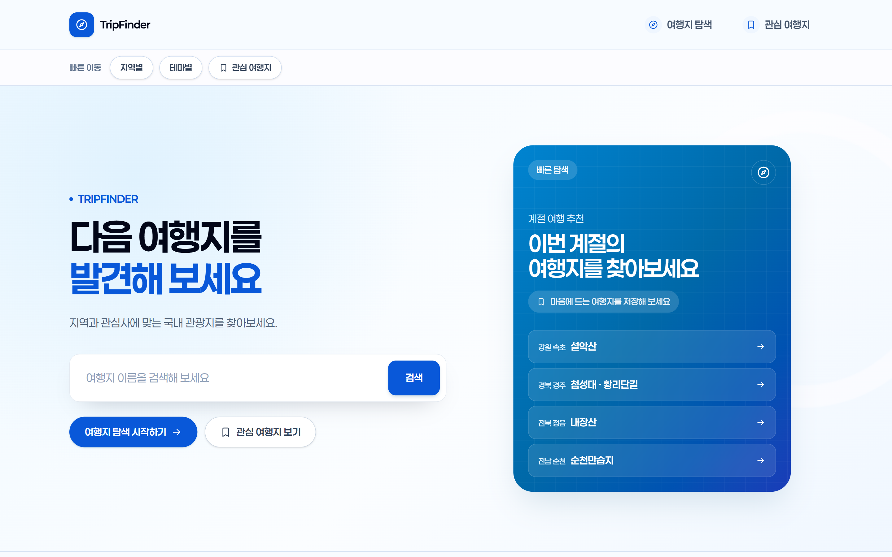
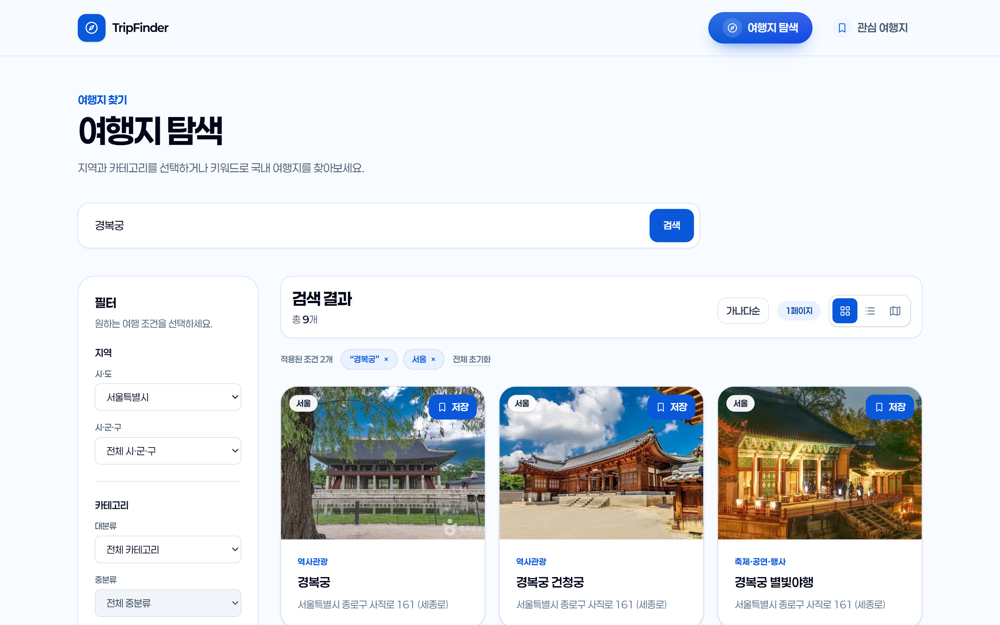
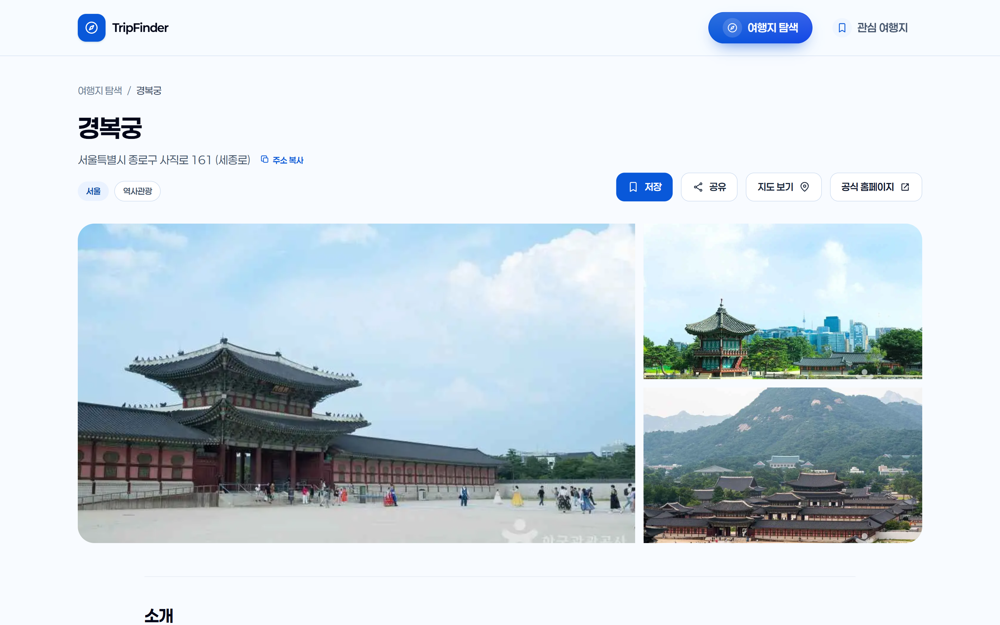
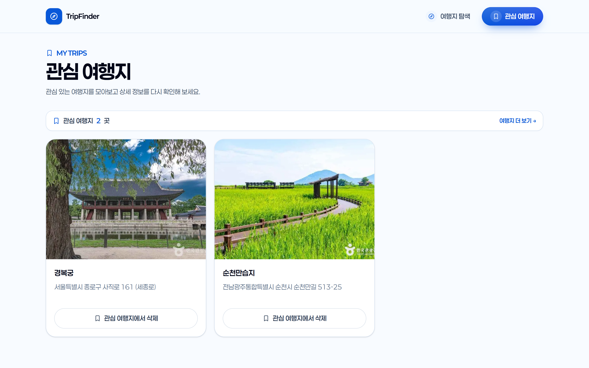

# TripFinder

[](https://github.com/minjuko/trip-finder/actions/workflows/ci.yml)

공공 관광 데이터를 바탕으로 국내 여행지를 검색하고, 상세 정보를 확인하고, 관심 장소를 저장하는 반응형 웹서비스입니다.

- 서비스 주소: https://trip-finder-mauve.vercel.app/

## 프로젝트 개요

| 항목 | 내용 |
| --- | --- |
| 형태 | 개인 프로젝트 |
| 개발 기간 | 2026.08 ~ 2026.11 |
| 주요 기술 | Next.js · React · TypeScript · PostgreSQL |
| 외부 데이터 | 한국관광공사 TourAPI |
| 검증 | Vitest · Playwright · GitHub Actions |

## 주요 기능 및 화면

<table>
  <tr>
    <td width="50%" valign="top">
      
      <br />
      <sub>홈 — 키워드 검색과 빠른 탐색으로 여행지를 찾습니다.</sub>
    </td>
    <td width="50%" valign="top">
      
      <br />
      <sub>탐색 — 지역·분류·키워드·정렬·이미지 조건으로 결과를 좁힙니다.</sub>
    </td>
  </tr>
  <tr>
    <td width="50%" valign="top">
      
      <br />
      <sub>상세 — 여행지 정보와 이미지, 지도·공식 홈페이지 이동을 확인합니다.</sub>
    </td>
    <td width="50%" valign="top">
      
      <br />
      <sub>관심 여행지 — 브라우저에 저장한 장소를 다시 확인하고 관리합니다.</sub>
    </td>
  </tr>
</table>

- 지역·관광 분류·키워드 검색과 카드, 목록, 지도 보기
- 제목순·수정일순·생성일순 정렬 및 대표 이미지가 있는 장소 필터
- 검색 조건을 URL에 보존해 링크 공유와 새로고침 후 상태 복원
- 상세 정보, 이미지 확대, 주소 복사, 공유 및 지도 연결
- 브라우저 북마크: localStorage 기반 관심 장소 저장·삭제
- 계정별 여행 목록: 목록 생성·수정·삭제, 장소 저장·삭제

## 기술 스택

| 구분        | 기술                                                                           |
| ----------- | ------------------------------------------------------------------------------ |
| 화면        | Next.js 16.4.5 App Router, React 19.2.8, TypeScript 5 (strict), Tailwind CSS 4 |
| 서버·저장 | Next.js Route Handlers (Node.js 런타임), Better Auth, PostgreSQL, Drizzle ORM |
| 데이터·지도 | 한국관광공사 TourAPI, Zod 4, Leaflet, OpenStreetMap                            |
| 검증        | Vitest, React Testing Library, Playwright, axe-core, GitHub Actions            |

## 핵심 구현 및 기술적 의사결정

- 서버 렌더링 화면과 검색·필터·저장처럼 상호작용이 필요한 클라이언트 화면을 나눴습니다.
- TourAPI 응답을 검증·정규화해 외부 응답 형식과 화면에서 쓰는 데이터를 분리했습니다.
- 검색 조건을 URL로 관리하고 TourAPI 정렬 조건에 연결해 직접 접근과 새로고침에서도 조건을 복원합니다.
- 인증·호출 제한·서버 오류를 구분하고 데이터 성격에 맞춰 캐시와 재검증 정책을 적용합니다.

- Next.js 서버 API에서 세션으로 목록 소유권을 확인합니다. PostgreSQL 제약으로 장소 중복 저장을 막고, 저장 요청이 겹칠 때 잠금과 버전 검사로 충돌을 처리합니다.

## 실행 방법

일반 실행에는 `.env.local`에 발급받은 `TOUR_API_SERVICE_KEY`가 필요합니다. 키를 저장소에 커밋하지 마세요.

```dotenv
TOUR_API_SERVICE_KEY=your_service_key
```

```bash
npm ci
npm run dev
```

| 명령                    | 설명                     |
| ----------------------- | ------------------------ |
| `npm run format:check`  | Prettier 형식 검사       |
| `npm run lint`          | ESLint 검사              |
| `npm run typecheck`     | TypeScript 검사          |
| `npm run test:coverage` | Vitest 및 coverage       |
| `npm run test:e2e`      | Playwright E2E           |
| `npm run build`         | Next.js production build |

계정별 목록 기능을 로컬에서 확인하려면 [`.env.example`](.env.example)을 참고해 `DATABASE_URL`, `BETTER_AUTH_SECRET`, `BETTER_AUTH_URL`을 설정하고 `npm run db:migrate`를 실행하세요. 인증 설정이 없으면 여행지 탐색과 브라우저 북마크를 사용할 수 있습니다. 아래 계정 기능 검증은 CI 환경 기준입니다.

## 테스트 및 검증

- **기본 검증:** Vitest, Playwright Chromium, 포맷·린트·타입 검사, 프로덕션 빌드. 여행지 탐색 E2E는 TourAPI 테스트 데이터를 사용합니다.
- **PostgreSQL 통합 검증:** 다른 계정의 목록 접근 제한, 동시 요청, 중복 저장 방지, 실패 시 롤백. [목록 테스트](scripts/verify-travel-lists-postgres.ts) · [목록 항목 테스트](scripts/verify-travel-list-items-postgres.ts)
- **브라우저–API–DB 통합 검증:** 목록 생성, 장소 저장·삭제 흐름. [GitHub Actions 실행 결과](https://github.com/minjuko/trip-finder/actions/runs/44774026984)

2026-10-14 로컬 Lighthouse 실험에서는 LCP와 전송량이 감소했지만 TBT는 악화됐습니다. 이는 아래의 현재 이미지 기준선과 별도인 과거 실험이며, 측정 조건과 한계는 [성능 분석 문서](docs/explore-performance-audit-2026.md)에 기록했습니다.

최신 기준 `ab4f6f5`의 탐색 E2E는 고정 TourAPI fixture·retry 0·5회 반복에서 dev 1 worker 20/20, dev 4 workers 17/20, production 4 workers 20/20 통과했습니다. dev 실패 원인은 확정하지 않았습니다. [실행 조건·trace 요약](docs/explore-origin-main-ab4f6f5-validation.md)

모바일 탐색 이미지 측정은 코드 변경 전 기준선입니다. 로컬 합성 fixture 5회에서 선택된 이미지 후보는 750px, 이미지 전송량 중앙값은 10,476 bytes였고, 공개 배포 관측은 별도 기록했습니다. 두 결과는 개선 효과 비교나 실제 사용자 현장 지표가 아닙니다. [조건·실행별 원시값](docs/explore-origin-main-ab4f6f5-validation.md#모바일-탐색-이미지-기준선과-공개-배포-관측)

별도 지도 지연 로딩 실험에서 production fixture의 eager preload와 현재 지연 로딩을 각각 5회 비교했습니다. 카드 보기의 4초 내 JS 전송 중앙값은 233,465 bytes에서 187,864 bytes로 줄었고, 지도 45,535-byte 청크 요청은 5/5회에서 0/5회로 바뀌었습니다. 이 실험에서 LCP 개선은 확인되지 않았습니다. [측정 환경·원본 결과·한계](docs/map-lazy-loading-validation.md)

## 관련 문서

- [모바일·접근성 감사](docs/mobile-accessibility-audit-2026.md)
- [Explore Lighthouse 과거 실험 기록](docs/explore-performance-audit-2026.md)
- [지도 지연 로딩 반복 측정](docs/map-lazy-loading-validation.md)
- [TF08 로컬 이미지 fixture 측정 방법](docs/tf08-local-image-performance-fixture.md)
