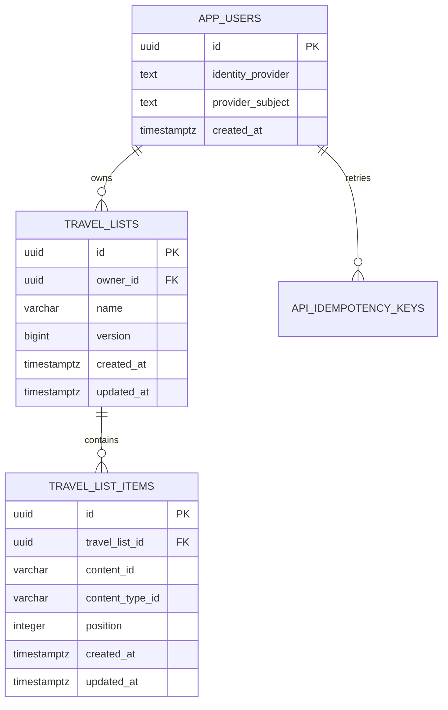

# TF-03a PostgreSQL 여행 목록 기능 설계

> 상태: 설계 제안. DB, ORM, 인증, API 및 UI는 구현되지 않았다. 사용자 승인이 필요한 정책은 이 문서에서 결정된 사실처럼 취급하지 않는다.

## 1. 목적과 기준

GitHub Issue [#9](https://github.com/minjuko/trip-finder/issues/9)의 사전 설계 문서다. 기준 `main` SHA는 `0e4e20a9d46c5b8348b04331da5587f4c9a57b5f`다. 이 SHA의 실제 코드 관찰과 새 여행 목록 설계를 별도 절로 구분한다.

이번 단계에서는 PostgreSQL 연결/DB 생성, 패키지 설치, 환경변수·Secret 등록, 코드 수정, 배포를 하지 않는다. DDL은 검토용 초안이며 실행하지 않았다.

## 2. 기존 코드 감사

### 관심 장소

- `src/lib/bookmarks/storage.ts`는 `trip-finder:bookmarks`에 `Bookmark[]` JSON을 저장한다. `src/lib/bookmarks/schema.ts`가 Zod로 `contentId`, `contentTypeId`, `title`, `address`, `thumbnailUrl`, `savedAt`을 검증한다.
- `addBookmark`는 `contentId`로 중복을 막고 새 항목을 배열 앞에 넣는다. 삭제도 `contentId`를 기준으로 한다.
- `BookmarkButton`과 `BookmarkList`는 `storage` 및 `bookmarkschange` 이벤트를 구독해 두 탭 간 변경을 반영한다. `e2e/bookmark.spec.ts`에는 저장·삭제·새로고침·두 탭 동기화가 검증되어 있다.
- `src/app/bookmarks/page.tsx`는 현재 `/bookmarks`를 표시한다. canonical은 `/bookmarks`, robots는 `index: false`, Open Graph URL은 `/bookmarks`다.
- 따라서 기존 관심 장소는 이 브라우저의 로컬 저장 기능으로 유지한다. 새 여행 목록은 별도의 서버 저장 데이터이며 자동 이전·공유·대체 동작을 하지 않는다. 한 장소를 북마크와 한 개 이상의 목록에 각각 추가할 수 있다.

### 인증, API, TourAPI 식별자

- 기준 SHA의 `package.json`에는 인증 라이브러리와 PostgreSQL 드라이버/ORM이 없다. `src`에서 auth/session/cookie 기반 로그인과 사용자 ID 흐름도 확인되지 않았다. `.env.example`에는 `TOUR_API_SERVICE_KEY`, `NEXT_PUBLIC_SITE_URL`만 있다.
- 기존 `src/app/api/classifications/route.ts`와 `src/app/api/regions/[regionCode]/districts/route.ts`는 Next.js App Router Route Handler다. 공개 GET 요청을 처리하고 Zod 응답 스키마를 사용한다. 이 공개 API만으로는 사용자의 사적 데이터를 인증하거나 소유권을 보호하지 않는다.
- `src/types/tour.ts`의 `TourContent`는 `id`, `contentTypeId`, `title`, `address`, `thumbnail`, 지역·분류·좌표를 정의한다. `src/lib/tour-api/normalizers/tour-content.ts`는 TourAPI의 `contentid`, `contenttypeid`를 문자열 `id`, `contentTypeId`로 정규화한다. 실제 상세 URL은 `/places/{contentId}`다.
- TourAPI 콘텐츠는 외부 원본이며 이 프로젝트 DB의 `places` 행이 아니다. 목록 항목은 외부 콘텐츠 ID를 문자열로 저장하고 콘텐츠 자체에 FK를 만들지 않는다. 표시용 제목·주소·thumbnail을 저장할지, TourAPI 재조회만 할지는 별도 결정이 필요하다.
- 기존 README의 Next.js `16.4.2` 표기는 오래된 설명이다. 실제 `package.json`/lockfile은 Next.js `16.4.5`다. README 정리는 이 설계 범위 밖이다.

## 3. 필요성과 제안 MVP

| 기능 | 제안 분류 | 설계 이유·결정 상태 |
| --- | --- | --- |
| 여행 목록 생성 | MVP 필수 | 관심 장소 전체와 목적별 그룹을 구분하는 기본 단위. 목록 개수 제한은 필요하나 상한은 운영·제품 결정 필요 |
| 이름 변경·삭제 | MVP 필수 | 목록을 계속 관리하기 위한 기본 CRUD. 삭제 시 목록 항목은 cascade 삭제 제안 |
| 여러 목록 관리 | MVP 필수 | 한 명이 여행 목적별 목록을 독립 생성. 같은 여행지를 서로 다른 목록에 각각 둘 수 있음 |
| 목록에 여행지 추가·제거 | MVP 필수 | 여행 계획 목록의 기본 편집 기능 |
| 같은 목록에 같은 여행지 중복 추가 | 중복 금지 | 목록별 `(travel_list_id, content_id)` UNIQUE. 재시도된 동일 추가는 기존 항목을 반환하는 멱등 PUT 제안 |
| 목록 내 순서 변경 | Phase 2 제안 | 방문 순서 관리에 유용하지만 reorder 전체 ID 계약, 원자적 재정렬 및 경쟁 테스트가 추가된다. MVP CRUD 수용 기준에서 제외하고 후속 승인 대상으로 둔다 |
| 여행지별 메모 | Phase 2 제안 | 유용하지만 개인 작성 데이터의 XSS, 길이 제한, 입력 UX가 추가된다. MVP CRUD 수용 기준에서 제외하고 후속 승인 대상으로 둔다 |
| 공개·공유 기능 | 후순위·이번 단계 제외 | 공개 URL 권한, 비공개 전환, 링크 폐기, 검색 엔진 정책을 별도 설계. 기본은 private |
| 브라우저·기기 간 동기화 | 계정 선택 시 MVP 필수 제안 | server-side owner identity가 있어야 가능. 익명 토큰이면 같은 브라우저 프로필에 한정. 인증 결정 전 확정 불가 |

목록 이름 중복 허용, 목록/항목 개수 상한, 소유자가 계정을 삭제할 때 데이터 즉시 삭제 여부는 정책 미결정이다. DDL 초안은 이름 중복을 허용한다. 별도 동의 전에는 북마크를 새 목록으로 복사하거나 서버에 업로드하지 않는다.

### MVP와 후속 Phase 경계

**MVP는 최소 CRUD**로 한정한다: 목록 생성·목록 조회(페이지네이션 포함)·이름 변경·목록 삭제, 목록 항목 조회·추가·제거. 목록은 여러 개 만들 수 있고, 같은 콘텐츠는 목록별 최대 한 번만 저장한다. 추가 시 서버가 TourAPI ID/type을 확인한다. MVP는 description, 방문 순서 변경, 여행지별 메모를 제공하지 않으며 API/UI/test acceptance criteria에도 포함하지 않는다. MVP item order는 서버가 append 순서로 정하고 클라이언트 변경을 받지 않는다.

**MVP 범위 밖**은 description, 순서 변경, 메모다. 제품이 description을 원하면 별도 결정 후 schema/API/UI를 함께 승인한다. Phase 2 reorder는 별도 endpoint와 keyboard-accessible UI, PostgreSQL race/rollback 검증을 포함한다. Phase 2 메모는 별도 PATCH 계약, plain-text 렌더링, 길이 정책 및 XSS/권한 검증을 포함한다. 공유·공개 URL은 별도 정책·위협 모델을 거치는 후속 단계다. 이 MVP 규칙은 이전 표의 “목록 내 순서 변경 MVP 필수 제안” 및 메모 API 초안보다 우선한다.

### 기존 북마크와 분리된 사용자 경험

- 새 탐색 항목은 “여행 목록”, `/bookmarks`와 기존 메뉴·문구는 “관심 여행지”로 구별한다.
- 목록 추가는 상세(`/places/{contentId}`)의 별도 “여행 목록에 추가” 동작으로 진입한다. 기존 저장/해제 버튼과 상태를 합치지 않는다.
- 새 기능은 북마크 저장소, 키, 데이터 타입, 두 탭 이벤트를 읽거나 수정하지 않는다. 향후 사용자가 직접 선택하는 “북마크에서 복사”가 필요해도 명시적인 사용자 액션과 중복 검사를 별도 설계한다.

## 4. 사용자 식별 및 보안 결정

모든 사적 CRUD는 서버가 검증한 principal을 필요로 한다. 요청 JSON의 `ownerId`를 받지 않는다. 서버가 세션의 안정적인 외부 `issuer + subject`를 검증한 뒤 내부 `app_users.id`로 매핑하고, DB 쿼리마다 해당 내부 ID를 조건으로 포함한다.

| 방안 | 난이도 | 보안·배포 적합성 | 포트폴리오 가치·한계 |
| --- | --- | --- | --- |
| 비로그인 단일 사용자 | 가장 낮음 | 방문자가 모두 같은 사용자인 서버 데이터는 공개 Vercel 앱에 부적합. 배포 전체를 단일 사용자로 막는 별도 보호가 있어야 하며 사용자별 접근·기기 복구를 제공하지 못함 | 빠른 demo지만 소유권 모델을 보여주지 못함 |
| 서버 세션 기반 회원 | 중간~높음 | HttpOnly 세션 쿠키를 서버에서 검증하고 매 요청 principal을 구성. 계정 회수·만료·CSRF·세션 저장 정책 필요 | 권한, 계정, DB 관계를 end-to-end로 설명하기 좋음 |
| 외부 인증 서비스(OIDC/OAuth) | 중간 | 로그인 UI·자격증명·MFA를 직접 관리하지 않고 공급자의 서명된 ID token/session을 서버에서 검증. 공급자 장애·계약·비용·claim mapping 고려 | Next.js와 외부 identity의 경계, 내부 권한 분리를 보여줄 수 있음. Auth.js 또는 관리형 Auth SDK 등은 선택 전 조사 필요 |
| 익명 사용자 토큰 | 중간 | 서버가 추측 불가능한 random token을 발급해 `HttpOnly; Secure; SameSite=Lax` cookie에 저장하고, DB에는 token hash만 기록. token 재발급·폐기·CSRF·쿠키 도메인을 설계해야 함 | 계정 없이 서버 저장 실험은 가능하지만 token 분실 시 복구 불가, 기기 간 동기화 없음. 익명 소유권은 계정으로 안전하게 이전하기 어려움 |

**추천은 조건부다.** 서버 DB 목록과 여러 기기 동기화를 제품 목표로 승인하면 외부 인증을 이용한 서버 검증 세션을 우선 평가한다. 인증 공급자와 로그인 방식은 결정하지 않는다. 계정 없이 단일 브라우저에서만 시험하려면 익명 token을 대안으로 비교하되, 소유권 복구/계정 이전을 먼저 정한다. 이 결정 전에는 TF-03b의 user-owned table/API를 구현하지 않는다.

### 인증 검증 책임과 구현 gate

인증 공급자 선택 전에는 auth SDK/library, callback route, cookie, user table, DB secret을 구현하거나 추가하지 않는다. 공급자 선택 뒤에는 다음 신뢰 경계를 구현·검증한다.

- OIDC callback에서 issuer를 설정된 allow-list와 정확히 비교하고, token signature를 discovery/JWKS의 신뢰된 key로 검증한다. `aud`가 이 애플리케이션의 client ID와 일치하는지, `exp`/`iat`가 유효한지, authorization flow의 `state`/`nonce`(및 public client라면 PKCE)가 요청 세션과 일치하는지 검사한다. 허용되지 않은 issuer/audience, 만료·잘못된 signature, nonce mismatch는 거부한다. JWT decode만으로 principal을 만들지 않는다.
- OIDC 검증과 application session 생성 책임은 server-only auth adapter에 둔다. API는 검증된 server session에서 `(issuer, subject)`를 받아 내부 `app_users.id`로 매핑한다. client body/query/header의 `ownerId`나 client-only state를 권한 근거로 쓰지 않고, 각 DB query에 `owner_id`를 적용한다.
- cookie session은 `HttpOnly; Secure; SameSite=Lax`와 최소 path/domain을 적용한다. cookie가 자동 첨부되는 POST/PUT/PATCH/DELETE는 same-origin `Origin` 검증과 CSRF 방어를 통과해야 한다. `Sec-Fetch-Site`는 추가 방어로 쓸 수 있지만 Origin/CSRF의 대체물이 아니다. GET/HEAD는 상태를 바꾸지 않는다.
- private API/page 응답은 `Cache-Control: private, no-store`; `Vary: Cookie`만으로 shared cache 안전을 대체하지 않는다. `DATABASE_URL`, session secret, OIDC client secret은 server-only runtime env에 두고 `NEXT_PUBLIC_`, source, issue/PR, logs, client bundle에 넣지 않는다. Dev/Preview/Production credential과 DB role/database를 분리한다. CI에는 production secret을 주지 않는다.
- 계정 삭제, 목록 cascade, export, backup retention, provider 계정 연결/해제 및 provider outage 접근 정책은 제품·법무 승인 전 미결정이다. DDL의 `ON DELETE CASCADE`는 즉시 삭제 정책 승인으로 해석하지 않는다.

### 위협과 필수 완화

| 위협 | 최소 방어선 |
| --- | --- |
| client가 다른 `ownerId`를 보내거나 바꿈 | owner 식별자를 API input에 넣지 않음. 검증된 server session에서 얻은 내부 `app_users.id`만 사용 |
| 목록 ID를 추측·복사하는 IDOR | 모든 조회·수정·삭제가 `id AND owner_id`를 함께 조건으로 삼는다. 타인 목록은 존재를 감추도록 `404 NOT_FOUND` 반환 |
| cookie 기반 write 요청의 CSRF | `SameSite=Lax`, `Secure`, `HttpOnly`, same-origin 정책, `Origin` 검증과 CSRF 보호. GET은 상태 변경 금지 |
| 공개 GET API/robots 정책을 접근 제어로 오인 | `/api/` robots disallow는 검색 크롤러 힌트일 뿐 인증이 아니다. private API는 매 요청 권한 검사 |
| 민감 데이터 cache/로그 노출 | 사용자 API와 페이지 응답에 `Cache-Control: private, no-store`; CDN/shared cache 제외. bearer/cookie, 메모·목록 내용은 로그에 기록하지 않음 |
| SQL injection, mass assignment, XSS | Zod strict input schema와 parameterized query/ORM binding; allow-listed fields만 수정. 메모는 plain text 렌더링하고 HTML 실행 금지 |
| 폭주·저장 자원 고갈 | per-user list/item 수 제한, 요청 크기 제한, 필요 시 rate limit. 배포 후 실제 사용량 관측 전 가격/상한 확정 금지 |
| 계정 삭제 후 잔존 데이터 | 사용자·목록 FK cascade 제안. 실제 deletion/export/retention 정책과 백업 보존 기간은 별도 승인 |

## 5. PostgreSQL ERD와 DDL 초안

### 개념 관계



### 논리 테이블

| 테이블 | 역할·주요 제약 |
| --- | --- |
| `app_users` | 검증된 identity `(identity_provider, provider_subject)`를 내부 UUID로 매핑. email을 외부 subject 대신 소유권 key로 사용하지 않음 |
| `travel_lists` | owner FK, 이름 1–80자 제안, `version` optimistic concurrency, `created_at`/`updated_at`. description은 MVP schema에서 제외하며 승인 후 migration 후보 |
| `travel_list_items` | MVP에서는 목록 FK, TourAPI `content_id` 및 `content_type_id` 문자열, `position`, 화면용 선택 snapshot. 같은 목록 content ID 중복 방지. `note` column은 Phase 2 승인 시 migration으로 추가 |
| `api_idempotency_keys` (선택) | 목록 생성 `POST` retry 방지가 필요할 때 owner-scoped idempotency key와 request hash/resource ID 보관. 보존 기간·재생 응답 정의가 승인되기 전에는 필수 도입하지 않음 |

아래는 회원 principal 기반의 PostgreSQL 15+ 초안이다. `app_users`는 실제 인증 라이브러리의 필수 schema가 아니라 해당 공급자 identity와 내부 owner를 분리하기 위한 projection table 예시다.

```sql
CREATE TABLE app_users (
  id uuid PRIMARY KEY DEFAULT gen_random_uuid(),
  identity_provider text NOT NULL,
  provider_subject text NOT NULL,
  created_at timestamptz NOT NULL DEFAULT now(),
  updated_at timestamptz NOT NULL DEFAULT now(),
  CONSTRAINT app_users_identity_unique
    UNIQUE (identity_provider, provider_subject)
);

CREATE TABLE travel_lists (
  id uuid PRIMARY KEY DEFAULT gen_random_uuid(),
  owner_id uuid NOT NULL REFERENCES app_users(id) ON DELETE CASCADE,
  name varchar(80) NOT NULL,
  version bigint NOT NULL DEFAULT 1 CHECK (version > 0),
  created_at timestamptz NOT NULL DEFAULT now(),
  updated_at timestamptz NOT NULL DEFAULT now(),
  CONSTRAINT travel_lists_name_nonempty
    CHECK (char_length(btrim(name)) BETWEEN 1 AND 80)
);

CREATE INDEX travel_lists_owner_updated_idx
  ON travel_lists (owner_id, updated_at DESC, id DESC);

CREATE TABLE travel_list_items (
  id uuid PRIMARY KEY DEFAULT gen_random_uuid(),
  travel_list_id uuid NOT NULL
    REFERENCES travel_lists(id) ON DELETE CASCADE,
  content_id varchar(64) NOT NULL,
  content_type_id varchar(8) NOT NULL,
  position integer NOT NULL CHECK (position >= 0),
  snapshot_title varchar(200) NOT NULL,
  snapshot_address text,
  snapshot_thumbnail_url text,
  snapshot_at timestamptz NOT NULL DEFAULT now(),
  created_at timestamptz NOT NULL DEFAULT now(),
  updated_at timestamptz NOT NULL DEFAULT now(),
  CONSTRAINT travel_list_items_content_unique
    UNIQUE (travel_list_id, content_id),
  CONSTRAINT travel_list_items_position_unique
    UNIQUE (travel_list_id, position)
    DEFERRABLE INITIALLY DEFERRED,
  CONSTRAINT travel_list_items_content_nonempty
    CHECK (char_length(btrim(content_id)) BETWEEN 1 AND 64),
  CONSTRAINT travel_list_items_type_digits
    CHECK (content_type_id ~ '^[0-9]{1,8}$')
);

CREATE INDEX travel_list_items_page_idx
  ON travel_list_items (travel_list_id, position, id);
```

**초안 해석:** 목록 삭제 또는 owner 삭제 시 목록 항목이 cascade 삭제된다. 외부 TourAPI 콘텐츠는 FK로 묶지 않는다. 이름 중복은 우선 허용한다. `updated_at`은 각 변경 쿼리에서 명시적으로 갱신한다(트리거는 초안에 없음). 표시 snapshot을 저장하면 TourAPI 장애 때 목록 카드를 유지할 수 있지만 원본 변경 후 stale할 수 있다. 서버가 `getTourDetail(contentId)`로 검증한 데이터만 snapshot에 사용하고, 클라이언트가 보낸 제목·이미지 URL은 신뢰하지 않는다. snapshot 저장 여부/refresh 정책은 미결정이다.

### 인덱스·비용·동시성

- owner 목록 페이지는 `(owner_id, updated_at DESC, id DESC)`를 사용해 owner 필터와 안정된 pagination을 지원한다.
- 항목 query는 `travel_list_id`와 정렬 key를 사용하고, `(travel_list_id, content_id)` UNIQUE가 중복 확인과 DB race 방어를 겸한다. 별도 content 전역 index는 필요할 때만 추가한다.
- page/limit의 최대치와 owner별 목록 수/목록별 항목 수를 정한다. 저용량 MVP에서 사용하지 않는 검색·부분 문자열 index는 추가하지 않는다.
- **MVP 직렬화 규칙:** 목록 metadata 변경과 목록 항목을 쓰는 모든 transaction은 먼저 owner 조건으로 parent `travel_lists` 행을 잠근다(`SELECT ... WHERE id = :listId AND owner_id = :ownerId FOR UPDATE`). 잠금 획득 뒤 목록 존재·소유권을 확인한다. item add/delete는 그 다음 현재 version과 요청을 비교한다. 모든 write path가 같은 parent lock 순서를 사용하므로 목록 단위 변경은 직렬화된다. 여러 목록을 동시에 바꾸는 기능이 생기면 list UUID 오름차순으로 잠근다.
- **항목 추가:** TourAPI ID/type 확인은 DB transaction 바깥에서 완료한다. transaction에서 parent 잠금 후 해당 content ID가 이미 있는지 먼저 확인한다. 같은 type의 기존 item이면 version이 이미 바뀌었더라도 그대로 `200` 반환(no-op 재시도); type이 다르면 `409 CONTENT_ID_CONFLICT`. 존재하지 않는 경우에만 요청의 `expectedVersion`을 current version과 비교하고 다르면 `409 VERSION_CONFLICT`; 일치하면 `(travel_list_id, content_id)` UNIQUE를 방어선으로 insert한다. position은 잠금 아래 `COALESCE(MAX(position), -1) + 1`로 append. 성공 insert는 parent version/timestamp를 한 번 갱신하고 `201`. 동시 중복 요청은 두 번째 요청이 잠금 뒤 같은 기존 item을 확인한다. 예상 밖 unique violation은 transaction rollback 뒤 재조회해 동일 결과로 변환하고, 그 외 오류는 rollback한다.
- **항목 제거:** owner-scoped parent lock으로 목록 존재와 소유권을 확인한다. 해당 항목이 이미 없으면 요청 version이 stale여도 목표 상태가 이미 충족된 no-op으로 `204` 반환하며 version/timestamp는 바꾸지 않는다. 항목이 있으면 `If-Match` version과 current version을 비교하고 stale이면 412, 일치하면 삭제와 parent version/timestamp 증가를 한 transaction에서 실행한다. position은 압축하지 않는다. 목록 전체 삭제는 owner 조건부 parent DELETE 한 번으로 실행하고 FK cascade를 사용한다.
- **항목/목록 순서:** MVP는 생성순 append(동률 tie-breaker는 item UUID)로만 조회하고 position을 API에서 수정하지 않는다. Phase 2 reorder는 parent 잠금 후 현재 전체 item 집합을 확인한다. 요청 ID 집합이 다르면 `422 ITEM_SET_MISMATCH`; 현재 순서와 요청 순서가 같으면 stale version이어도 no-op `200`/version 불변이다. 실제 순서가 달라질 때 `expectedVersion`을 비교하고 stale이면 `409 VERSION_CONFLICT`; 일치하면 한 transaction에서 position을 `0..n-1`로 재작성한다. `travel_list_items_position_unique DEFERRABLE INITIALLY DEFERRED`가 commit 시점에 검사되며 중간 SQL 상태의 충돌은 허용한다. validation, constraint, commit 중 하나라도 실패하면 모든 item 변경과 version 갱신이 rollback된다.
- **Version/timestamp:** `travel_lists.version`은 생성 시 1이다. 목록 이름 변경 및 item의 실제 추가/삭제가 commit될 때 parent version을 정확히 1 증가시키고 `updated_at = transaction_timestamp()`를 함께 갱신한다. `created_at`은 불변이다. no-op은 version/timestamp를 올리지 않는다. 변경하려는 operation이 이미 목표 상태라면 stale precondition보다 no-op을 우선해 동일 결과를 반환한다(PATCH same-value `200`, duplicate PUT `200`, absent item DELETE `204`). 실제 변경이 필요한 때만 stale version을 거부한다. list PATCH와 item PUT은 JSON `expectedVersion`; item DELETE는 `If-Match: "list-vN"`을 사용한다. list create에는 version precondition이 없고 list DELETE는 owner-scoped atomic delete를 사용한다.
- **동시성 결과:** 동일 version을 가진 서로 다른 두 mutation이 경합하면 parent lock 이후 첫 변경만 성공하고 version을 올린다. 두 번째 요청은 잠금 해제 후 stale version을 발견해 409가 된다. 클라이언트가 현재 내용을 GET하고 사용자가 다시 적용해야 하며 서버가 자동 merge하지 않는다. `PUT` 중복 요청은 위의 기존 항목 반환 규칙이 적용된다. 동일값 PATCH·삭제 재시도도 no-op 결과가 일관된다.
- **페이지네이션 일관성:** 목록 페이지는 `(updated_at DESC, id DESC)` keyset cursor를 사용한다. 각 목록의 version은 서로 다른 값이므로 cursor는 목록 version을 하나로 대표하지 않는다. 목록이 페이지 사이에 수정되어 `updated_at` 기준으로 이동하면 traversal은 best-effort이며 항목이 누락/재등장할 수 있다. 응답은 각 row version을 전달하고 UI는 mutation 뒤 목록 첫 페이지를 다시 조회한다. item 조회는 `(position,id)` keyset cursor에 parent list version을 넣는다. 해당 version이 변하면 다음 page는 `409 CURSOR_STALE`이며 처음부터 재조회한다. 동일 version 안에서만 page 누락/중복이 없음을 보장한다. offset/page와 concurrent mutation 간 snapshot 보장은 주장하지 않는다.
- **Idempotency 구분:** MVP의 item 추가는 `PUT`와 UNIQUE 조합으로 동일 요청 재시도에 멱등이다. item DELETE는 이미 없음도 204여서 효과상 멱등이다. 실제 값이 바뀌지 않는 PATCH는 version을 올리지 않아 멱등 재시도가 가능하다. 목록 `POST`는 기본적으로 non-idempotent이며 network timeout 후 재전송은 duplicate list를 만들 수 있다. MVP에서는 idempotency table을 넣지 않고 UI의 중복 클릭 방지만 한다는 위험을 명시한다. 목록 생성의 안정적 network retry를 MVP launch requirement로 승인할 경우 별도 `Idempotency-Key`를 도입한다: owner + key unique, canonical request hash, resource ID 및 재생할 status/body를 저장하고, 동일 key·동일 hash는 최초 응답을 replay, 동일 key·다른 hash는 `409 IDEMPOTENCY_KEY_REUSED`, 동시 요청은 key row 잠금으로 한 번만 생성한다. 보존 TTL은 정책 승인 전 미정이다.
- **삭제 경합:** list delete와 item add가 경합해도 parent 행 lock/DELETE의 PostgreSQL row lock 순서로 직렬화한다. add가 먼저 commit하면 list delete cascade가 item을 포함해 삭제한 뒤 204; list delete가 먼저 commit하면 add는 parent 재조회에서 404. 최종 상태에 orphan item이 없어야 한다.
- **Rollback 및 PostgreSQL 검증:** 콘텐츠 확인 실패, stale version, 잘못된 item 집합, UNIQUE/FK/CHECK 위반, 중간 쿼리/commit 실패 시 transaction 전체가 rollback되어 item과 parent version/timestamp가 함께 원상복구되어야 한다. 실제 PostgreSQL 통합 테스트에서 이 규칙을 검증한다. mock DB만으로 race 보장을 주장하지 않는다.

### 마이그레이션·데이터 운영

- 초기 migration은 위 schema 및 인덱스를 만들고, down/rollback은 파괴적 데이터 삭제가 없는지 검토한다. 버전 관리 SQL migration 한 가지를 schema source of truth로 선택한다.
- 개발/CI에서는 disposable DB에 migration을 처음부터 실행한다. 운영은 backup·검증된 migration artifact·명시적 승인 후 배포 절차에서 한 번 실행하며 request cold start에서 DDL을 실행하지 않는다.
- 이후 schema 변경은 expand → 코드 호환 배포 → data backfill 검증 → contract 단계로 쪼갠다. 직접 운영 DB 콘솔 수정은 migration으로 복귀시킨다.
- API write transaction은 DB에서만 짧게 수행한다. 항목 추가는 인증된 principal과 owner-scoped 목록 사전 확인을 먼저 수행해 타 owner/없는 목록에는 TourAPI를 호출하지 않는다. 그 뒤 TourAPI 콘텐츠 조회/검증을 row lock 없이 수행하고, 짧은 transaction에서 parent owner lock·현재 존재 여부·version·unique 제약을 다시 확인한다. 사전 확인 뒤 목록이 삭제/변경될 수 있으므로 transaction 안의 재검증이 최종 판단이다.
- item page와 `listVersion`은 같은 PostgreSQL statement snapshot에서 읽는다(단일 query 또는 `REPEATABLE READ` read-only transaction). 먼저 version을 읽고 별도 query로 items를 읽는 방식은 그 사이 mutation이 생기면 cursor와 데이터가 다른 version을 가리킬 수 있으므로 금지한다. continuation cursor에 담긴 version이 query snapshot의 current version과 다르면 빈/부분 결과 대신 `409 CURSOR_STALE`을 반환한다.

## 6. API 계약 제안

### 프레임워크 선택

같은 Next.js 프로젝트의 **Route Handler**를 우선 제안한다. 현재 앱은 App Router, TypeScript, Zod, `NextResponse.json`의 공개 server route 패턴을 이미 사용한다. 동일 origin UI에서 session cookie를 이용하고 서버에서 DB secret을 보호할 수 있다. 별도 서버는 background job, 독립 배포·autoscaling, 장시간 작업, 다른 client/API consumer가 실제 요구될 때 추가할 근거가 생긴다. 초기 private CRUD를 위해 두 번째 서비스·CORS·별도 auth forwarding을 먼저 도입할 필요는 없다.

DB client가 필요한 Route Handler는 `runtime = "nodejs"`의 Node runtime으로 운용한다(Edge runtime 연결은 provider/driver가 명시 지원될 때만 검토). Server Component는 같은 앱의 Route Handler를 자기 자신에게 HTTP 호출하기보다 auth 검증 후 application service를 직접 호출하고, Client Component의 mutation은 Route Handler를 사용한다. 모든 개인 응답은 `Cache-Control: private, no-store`로 제안한다.

### 공통 계약

- Base path: `/api/travel-lists`
- 인증: 인증 공급자/세션이 승인·구현되기 전에는 어떤 endpoint도 구현하지 않는다. 구현 후 모든 endpoint는 server-verified session principal이 필요하다. `ownerId` 필드는 request에 허용하지 않는다. 미인증 `401`; 타 owner와 없는 객체 모두 같은 JSON shape의 `404 NOT_FOUND`.
- 입력: Zod `.strict()` schema로 unknown field 거부. MVP 목록 이름은 trim 후 1–80자, `contentId` 1–64자, `contentTypeId` 숫자 1–8자리 제안. MVP 밖 Phase 2 메모는 최대 500자 제안. UUID/path/query와 `expectedVersion` positive integer를 검증한다. description/note field는 MVP schema에서 거부한다.
- 콘텐츠 추가 시 client는 ID만 보낸다. 서버가 기존 TourAPI detail service로 ID·type과 canonical title/address/thumbnail을 확인한다. 찾을 수 없음 `404 CONTENT_NOT_FOUND`, 외부 source unavailable은 `503 CONTENT_SOURCE_UNAVAILABLE`; untrusted snapshot 저장 금지.
- 공통 오류 JSON: `{"error":{"code":"VERSION_CONFLICT","message":"목록이 다른 요청에서 변경되었습니다.","requestId":"..."}}`. stack, SQL, token 및 provider 응답은 노출하지 않는다.
- `400` JSON/query/path/Zod 입력 오류, `401` 미인증, `403` same-origin/CSRF 검증 거부, `404` 없음·타 owner 객체(`NOT_FOUND`) 또는 TourAPI에 없는 콘텐츠(`CONTENT_NOT_FOUND`), `409` stale JSON `expectedVersion`/list limit/idempotency/content identity 충돌, `412` stale `If-Match`, `422` 형식은 유효하지만 허용되지 않는 콘텐츠 type, `428` 필수 `If-Match` 누락, `429` rate limit, `503` DB/TourAPI 의존 서비스 불가. 두 version 전달 방식을 한 endpoint에서 혼합하지 않는다.
- 목록 조회는 `limit=20&cursor=...`(최대 100)을 사용한다. 목록 cursor는 `(updated_at,id)` 기준이며 서로 다른 list version을 하나로 묶지 않는다. 수정으로 페이지 간 row 순서가 바뀔 수 있는 best-effort pagination이다. item 조회 cursor는 `(position,id,listVersion)` 기준으로, version 변화 시 `409 CURSOR_STALE`. total count는 MVP 응답에 넣지 않는다.
- 모든 item write는 parent lock을 따른다. 실제 상태 변경이 필요한 목록 PATCH와 item PUT은 JSON `expectedVersion`이 필수이며 item DELETE는 `If-Match: "list-vN"`을 요구한다. 현재 상태가 요청의 목표 상태와 같아 no-op인 경우 stale precondition과 무관하게 no-op 응답을 반환하고 version/timestamp는 유지한다. field가 없거나 unknown field가 있으면 `400`. 목록 생성은 version precondition이 없다. list DELETE는 `If-Match`를 받지 않고 owner-scoped atomic delete를 수행한다.
- 권한 검사와 조회/변경은 owner 조건을 포함한 동일 쿼리/transaction 경계에서 수행한다. 타 owner ID를 존재하는지 없는지 구별할 수 없게 404 status와 동일 오류 JSON을 반환하고, error text·응답 크기·로그에서 owner 존재를 노출하지 않는다.

### endpoint 계약

| Method / Path | 인증 | Request JSON / 검증 | Response JSON / 성공 | 실패·중복·소유권·pagination·동시성 |
| --- | --- | --- | --- | --- |
| `GET /api/travel-lists?limit=20&cursor=...` (MVP) | 필수 | body 없음. Zod: limit 1–100, opaque cursor | `200` `{"items":[{"id":"uuid","name":"부산 여행","itemCount":3,"version":4,"createdAt":"...","updatedAt":"..."}],"nextCursor":null}` | 미인증 401. `owner_id` filter. order `updated_at DESC,id DESC`; keyset cursor `(updated_at,id)`. list별 version snapshot은 보장하지 않는 best-effort pagination. `totalCount` 없음. 타 owner 결과 미노출 |
| `POST /api/travel-lists` (MVP) | 필수 | `{"name":"부산 여행"}`. strict Zod, trim, 1–80자. description/owner 금지 | `201` `{"id":"uuid","name":"부산 여행","version":1,"createdAt":"...","updatedAt":"..."}` | 미인증 401. list name 중복 허용. 일반 POST retry는 중복 목록 생성 가능; idempotency key 승인 전 non-idempotent라 자동 재전송 금지. owner 상한 도달은 `409 LIST_LIMIT_REACHED` 제안 |
| `GET /api/travel-lists/{listId}` | 필수 | body 없음. UUID path 검증 | `200` `{"id":"uuid","name":"부산 여행","version":4,"createdAt":"...","updatedAt":"..."}` | 다른 owner/없음 모두 동일 `404 NOT_FOUND`. pagination은 별도 items endpoint |
| `PATCH /api/travel-lists/{listId}` (MVP rename) | 필수 | `{"name":"제주 일정","expectedVersion":4}`. name만 허용; strict Zod, owner/description 금지 | 실제 변경·no-op 모두 `200` 최신 list JSON | parent 잠금 후 값 확인. no-op은 stale version이어도 200/version 불변. 실제 변경은 version 비교, stale `409 VERSION_CONFLICT`; 변경 시 version +1/timestamp 갱신. 타 owner/없음은 동일 404 |
| `DELETE /api/travel-lists/{listId}` | 필수 | body 없음. `If-Match` 없음; parent lock/owner 조건으로 동시 삭제 조정 | 첫 삭제 `204` no content | 삭제된 row가 1개면 items cascade. 이미 삭제/타 owner면 `404 NOT_FOUND`(삭제 retry도 404로 정의; 최초 결과를 보장하는 HTTP 멱등 응답과 재생 응답은 구분). 원자적 owner-scoped DELETE |
| `GET /api/travel-lists/{listId}/items?limit=20&cursor=...` (MVP) | 필수 | body 없음. Zod limit 1–100, opaque cursor | `200` `{"items":[{"id":"uuid","contentId":"127480","contentTypeId":"12","title":"가거도","address":"...","thumbnailUrl":"...","position":0,"createdAt":"..."}],"nextCursor":null,"listVersion":4}` | owner 검사 후 단일 statement/repeatable-read snapshot에서 version과 page를 함께 읽는다. 타 owner 404. cursor version이 snapshot의 list version과 다르면 `409 CURSOR_STALE`; 같은 version에서 keyset pagination. MVP에는 note 필드 없음 |
| `PUT /api/travel-lists/{listId}/items/{contentId}` (MVP) | 필수 | `{"contentTypeId":"12","expectedVersion":4}`. ID path 및 strict body 검증. 서버가 TourAPI snapshot 확인 | 새 항목 `201`; 이미 같은 항목이면 `200` 기존 representation | parent lock. 기존 동일 ID/type면 stale version이어도 no-op `200`; 기존 ID/type 충돌은 `409 CONTENT_ID_CONFLICT`. 새 항목일 때만 version 검사(stale `409`), 추가 및 version +1. UNIQUE race 보호. owner/목록 없음은 404 |
| `DELETE /api/travel-lists/{listId}/items/{contentId}` (MVP) | 필수 | body 없음. `If-Match: "list-v4"` 필수 | 삭제 또는 이미 없음 모두 `204` | parent lock 후 item 부재면 stale 여부와 무관하게 no-op `204`; 존재하면 If-Match 비교, stale `412 PRECONDITION_FAILED`, 일치하면 delete와 version +1. 목록 없음/타 owner는 404 |
| `PATCH /api/travel-lists/{listId}/items/{contentId}` (Phase 2: 메모) | 필수 | `{"note":"오전 방문","expectedVersion":4}` 또는 note null. strict Zod, 500자 정책 제안 | `200` item + `listVersion` | MVP에서 구현 금지. parent lock/version; 값 변경 때만 version +1/timestamp. no-op은 유지 |
| `PUT /api/travel-lists/{listId}/items/order` (Phase 2: reorder) | 필수 | `{"itemIds":["uuid-1","uuid-2"],"expectedVersion":4}`. array unique; 정확한 전체 item set | 순서 변경 `200` version +1; 이미 같은 순서면 `200` 현재 version | MVP에서 구현 금지. parent `FOR UPDATE`; 집합 다르면 `422 ITEM_SET_MISMATCH`; 같은 순서는 stale version이어도 no-op. 실제 순서 변경은 stale `409`, 지연 UNIQUE constraint, transaction 원자성 적용 |

어느 request에도 owner identity를 넣지 않는다. status와 공통 오류 응답은 구현 시 Zod/API contract test로 고정한다. `GET /api/travel-lists/{id}`가 items를 함께 포함할지 여부는 UI 데이터량 결정을 반영해 구현 전에 하나로 확정한다. 위 초안은 목록 metadata와 cursor 기반 item 조회를 분리한다.

### 쓰기 요청 결과·멱등성 결정표

| 요청 | 적용 규칙 | 응답 |
| --- | --- | --- |
| 목록 PATCH: 실제 변경 | parent lock 후 현재 값 확인; 값이 다르면 `expectedVersion` 검사 후 update/version +1 | `200` 최신 representation; stale 변경은 `409` |
| 목록 PATCH: 같은 값 재요청 | parent lock 후 목표값이 이미 충족되면 version 비교에 우선해 no-op; version/timestamp 불변 | `200` 현재 representation, even if supplied version is stale |
| item add PUT: 신규 | parent lock 후 item 존재 여부 확인; 없을 때 `expectedVersion` 검사 후 insert/append/version +1 | `201`; stale 신규 추가는 `409` |
| item add PUT: 중복/재시도 | 같은 ID/type existing row를 바꾸지 않고 반환. type 충돌은 변경 없이 오류 | `200` 기존 item 또는 `409 CONTENT_ID_CONFLICT`, version 불변 |
| item DELETE: 실제 삭제 | parent lock 후 item 존재 확인; 있으면 `If-Match` 검사 후 delete/version +1 | `204`; stale 삭제는 `412 PRECONDITION_FAILED` |
| item DELETE: 이미 없음 | 목록 owner 확인 후 no-op, stale If-Match라도 version/timestamp 불변 | `204` |
| list DELETE: 실제 삭제 / 이미 없음·타 owner | 실제 row 삭제는 cascade. 이미 없음과 타 owner는 동일하게 숨김 | 최초 `204`; 재시도·비소유자 `404 NOT_FOUND` |
| 실제 변경이 필요한 mutation의 stale version | 어떤 자식 row도 바꾸기 전에 거부 | JSON `expectedVersion`은 `409 VERSION_CONFLICT`; `If-Match`는 `412 PRECONDITION_FAILED`. owner 검증된 경우에만 current version 제공 |

타 owner 객체에는 어떠한 version도 내보내지 않는다. item/list PATCH의 no-op 재시도는 현재 저장 상태가 요청의 목표값과 정확히 같을 때만 precondition 검사보다 우선한다. PUT 중복도 같은 `contentId`와 `contentTypeId`가 일치하는 경우만 성공 no-op이다. 다른 변경이 필요한 stale 요청은 정해진 409/412를 반환한다. 세션 만료와 CSRF 오류는 DB 조회 전에 끝낸다.

## 7. 화면·접근성 흐름

### 라우팅·구조

- 새 route 후보: `/travel-lists` 목록, `/travel-lists/{listId}` 상세. UUID는 예측 방어용이 아니라 identifier이며 authorization은 매번 서버에서 한다.
- `/travel-lists/**`는 private 및 `noindex`로 제안하고 sitemap에 넣지 않는다. 로그인 전에는 내용을 SSR로 내보내지 않고 로그인 안내/진입만 렌더링한다. 공개 목록이 승인되면 별도 공개 route, URL, canonical·robots를 설계한다.
- 기존 `/bookmarks` canonical `/bookmarks`, noindex와 localStorage 동작을 유지한다. 새 페이지 metadata가 root policy를 상속할 때 private noindex가 유지되는지 별도 metadata test를 둔다.

| 화면/흐름 | 책임 제안 |
| --- | --- |
| `/travel-lists` 목록 | Server Component가 auth 확인 후 사용자 목록/page 결과를 로드. `TravelListOverview`는 목록 카드와 empty state. 생성 폼은 별도 Client Component |
| 목록 생성·이름 변경 | `TravelListForm`은 name Zod 제한과 field error를 표시하고 pending 상태에서 중복 submit 방지. 서버는 다시 검증. MVP에는 description 입력이 없음 |
| 목록 삭제 | 확인 dialog에 목록 이름과 “항목도 함께 제거”를 알리고 완료 후 목록 목록 갱신. cancel이 keyboard로 가능 |
| `/travel-lists/{id}` 상세 | server owner-checked load. `TravelListHeader`, `TravelListItems`, `TravelListItemActions`가 metadata와 제거를 분리. MVP는 append 순서만 표시하며 reorder control과 note UI 없음 |
| 상세에서 목록 추가 | 상세 route의 기존 북마크 버튼과 나란히 별도 “여행 목록에 추가” 버튼. `AddToTravelListDialog`는 목록을 선택하고 add를 요청. 목록 없음이면 create flow 링크 |
| 비로그인 | 로그인 방식 승인 후 sign-in action, session 없음 메시지. 사용자 목록의 제목/개수/content는 응답·HTML에 포함하지 않음 |
| loading/empty/error | `loading.tsx` 또는 section skeleton, 목록 없음과 항목 없음의 분리된 CTA, retry 가능한 오류/로그인 만료 표시. TourAPI unavailable은 DB 저장 오류와 구별 |

모바일 우선 단일 컬럼, 충분한 터치 target, overflow 없는 긴 여행지/목록 이름을 제공한다. Dialog는 accessible name, focus 이동·복귀, Escape, 명시적 cancel을 지원한다. 목록/항목 CRUD는 keyboard-only 조작과 field에 연결된 오류를 제공하며 색상만으로 저장/권한 상태를 표현하지 않는다. Phase 2 reorder를 승인하면 drag-only를 금지하고 keyboard 위/아래 이동 버튼 또는 메뉴, `aria-live` 결과 알림, 모바일 터치 조작을 함께 설계한다. React component에는 server data/service와 client interaction 경계를 명확히 둔다.

## 8. 개발·배포·테스트 전략

### PostgreSQL 호스팅 비교 (2026-11-19 검토)

| 후보 | Vercel/서버리스 적합성 | 무료·비용/운영 참고 | 이 프로젝트 적합도 |
| --- | --- | --- | --- |
| Neon + Vercel Marketplace | Vercel에서 integration으로 연결 가능. Vercel deploy preview별 branch integration 선택지가 있고 pooled/serverless 연결 제품 제공 | 2026-10 Neon 안내는 Free project에 최대 1 GB storage를 공지했다. compute, branch, egress 등 quota 이후는 사용량에 좌우되며 유료 가격은 고정 월액이 아닐 수 있음 | **조건부 1순위 후보**: 현재 Vercel 배포와 Preview DB 분기 연결이 잘 맞고 PostgreSQL 자체를 직접 다루는 portfolio 가치가 있음. Auth는 별도 선택해야 함 |
| Supabase Postgres | Vercel serverless는 shared transaction pooler 사용을 안내. transaction mode에서는 prepared statement를 끄고 client pool을 작게 설정하는 등 driver 조정 필요 | 공식 pricing 기준 Free는 DB 500 MB, 비활성 1주 후 pause, active free projects 2개 제한. Pro는 현재 $25/month 시작. 포함량·추가 과금 재확인 필요 | **통합 대안**: Auth와 DB를 함께 제공해 identity 선택/운영 단순화가 가능. Data API/RLS를 쓸지 Next Route Handler 소유권 검사를 유지할지 선택 필요 |
| Render Postgres | Vercel에서 외부 DB로 연결 가능하지만 네트워크·region·pooling 구성은 별도 점검. 내장 PgBouncer pooling은 paid DB에서 제공 | Free Postgres는 1 GB이고 생성 30일 후 만료; 무료 pooler도 없음. 가격표에는 유료 compute tier가 별도 표시됨 | 테스트/demo 한시 DB에는 쓸 수 있지만 지속 저장의 무료 기본값으로 추천하지 않음. Vercel 외부 운영 플랫폼 하나를 추가함 |

**잠정 선택 제안:** Vercel과 deploy preview DB branch 연계를 중시한다면 Neon을 먼저 검증하고, 로그인과 DB를 한 공급자에서 단순히 운영하는 게 우선이면 Supabase와 Supabase Auth 조합을 검토한다. 비용은 사용량/region/backup 설정에 따라 바뀌므로 실제 계정 생성이나 과금 결정을 하지 않았다. 이 추천과 hosting provider는 사용자 승인이 필요한 미결정 사항이다.

공식 자료:

- [Vercel Marketplace storage integrations](https://vercel.com/docs/marketplace-storage)
- [Neon on Vercel Marketplace](https://vercel.com/marketplace/neon)
- [Neon Free plan의 1 GB 안내 (2026-10)](https://neon.com/blog/neon-free-plan-1-gb-per-project)
- [Supabase pricing](https://supabase.com/pricing)
- [Supabase Postgres connection modes](https://supabase.com/docs/guides/database/connecting-to-postgres)
- [Supabase serverless driver/pool guidance](https://supabase.com/docs/guides/database/connecting-to-postgres/serverless-drivers)
- [Render free Postgres limitations](https://render.com/docs/free)
- [Render Postgres connection pooling](https://render.com/docs/postgresql-connection-pooling)

### Environment 및 연결

- server-only `DATABASE_URL`은 `NEXT_PUBLIC_` prefix를 붙이지 않는다. `.env.local`은 ignored local-only, `.env.example`에는 변수명만 빈 값으로 둔다. Vercel의 Development/Preview/Production 변수와 DB role/database를 분리한다. 실제 secret을 문서, GitHub issue, client bundle, CI log에 쓰지 않는다.
- `DATABASE_URL`은 serverless pooled URL을 사용하고 application DB client는 module scope에서 생성하며 function instance당 connection 수를 낮춘다. 요청마다 pool을 만들지 않는다. 사용 driver가 transaction pooler에서 prepared statement, session state, advisory lock을 요구하지 않는지 확인한다.
- migration용 직접 연결이 필요하면 운영 API runtime과 별도 `DATABASE_MIGRATION_URL`을 migration-only job에 주입하고 runtime에는 권한이 제한된 role을 쓴다. provider가 허용하지 않으면 pooler를 지원하는 migration 경로를 검증한다.
- `AUTH_SECRET`/provider credentials는 서버 전용 Vercel/GitHub Secret으로 관리하며 서로 다른 environment 값 사용. 실제 secret 값은 이번 TF-03a에서 만들거나 조회하지 않는다.
- Next.js Route Handler에서 pooler는 request concurrency를 돕지만 무제한 연결을 의미하지 않는다. Vercel function 수 × instance pool이 DB connection limit에 닿지 않는지 observability와 provider limit으로 조정한다. Edge runtime은 첫 구현에서 피한다.

### DB 분리·테스트 데이터 안전

| 환경 | DB 정책 |
| --- | --- |
| 개발자 로컬 | local PostgreSQL container 또는 개인 dev DB. production URL 복사 금지. seed는 deterministic fake owner/TourAPI fixture |
| GitHub Actions | job마다 disposable PostgreSQL service/database, production secret 없이 migration 후 test. job 종료 시 폐기 |
| Vercel Preview | 별도 preview database 또는 provider branch. production data/schema를 복제할 경우 개인정보 제거와 비용·수명 제한을 먼저 정함 |
| Vercel Production | 승인된 운영 DB만 runtime에 연결. fixture flag/test clear/TRUNCATE 경로 금지 |

통합 test는 DB 이름/host가 허용된 test target인지 실행 전 검사하고, 테스트 시작 시 migration history를 검증한다. 생성 데이터는 test transaction 또는 test-only random namespace로 정리한다. `TRUNCATE ... CASCADE` 정리는 disposable CI DB에서만 허용하며 production URL에서 실행을 fail-fast 차단한다. 실 TourAPI 대신 `TOUR_API_E2E_FIXTURES=true` 또는 repository mock으로 외부 호출을 막는다.

### 검증 매트릭스

| 범주 | 필수 시나리오 |
| --- | --- |
| schema/migration | 빈 DB에 up migration, schema/unique/FK/index 검증, 실패 migration rollback, 이전 version에서 expand migration |
| Zod/API (MVP) | 잘못된 UUID, 빈/초과 이름, unknown field/ownerId/description/note 차단, page/limit/cursor/expectedVersion/If-Match 잘못된 값과 누락된 precondition, 공통 error shape |
| Zod/API (Phase 2) | 승인된 note endpoint의 빈/초과 메모 및 unknown field 검증 |
| 권한 | 미인증 401, owner A/B 생성. B가 A의 list/item read/update/delete/reorder를 요청해 404이며 A data는 그대로. client ownerId 바꿔도 영향 없음 |
| duplicate (MVP) | 같은 목록 동시 동일 콘텐츠 추가 결과 row 1개, 두 목록에 같은 content ID 허용, PUT 최초 `201`/재시도 `200` representation 일치, 잘못된 content type 충돌, 중복 no-op의 version/timestamp 불변 |
| transaction/race (MVP) | PostgreSQL에서 동시 add/add, add/delete, delete/delete. 모든 변경이 parent `FOR UPDATE`를 획득하고 같은 version 변경 요청은 먼저 성공한 한 건만 변경, 나머지는 stale `409`; 실패 시 item 및 parent version/timestamp 원자적 rollback |
| transaction/race (Phase 2 reorder) | reorder/add/delete 경합, 같은 순서 no-op, stale version, item ID 집합 mismatch, deferrable position UNIQUE 충돌 rollback, commit 후 `0..n-1` position 연속성 |
| PATCH/DELETE semantics | 같은 값 PATCH `200` no-op/version 불변, 실제 변경 version +1, stale actual mutation 실패, item DELETE 성공/재시도 모두 204, 목록 DELETE 최초 204·재시도 404, 타 owner/없는 목록 동일 404 |
| delete/restore | list delete cascade와 동시 item 추가 경합, item remove 후 같은 content 재추가 및 append position, user delete/retention은 정책 승인 전 동작 고정 금지 |
| paging | 안정 sort와 keyset cursor. item cursor는 list version 변화 후 `409 CURSOR_STALE`; 목록 collection은 여러 list version을 하나의 snapshot으로 표현할 수 없으므로 best-effort traversal과 refresh UX 검증 |
| CSRF/cache/log | wrong Origin/CSRF 거부, private no-store header, credential/개인 내용 미로그, SQL binding. 메모 plain-text 및 XSS 검증은 Phase 2 |
| 기존 기능 회귀 | 기존 `e2e/bookmark.spec.ts` 저장·삭제·두 탭 동기화·새로고침, `/bookmarks` noindex/canonical, TourAPI fixture 상세/탐색, 검색 URL 상태, 지도 지연 로딩 유지 |
| 접근성 (MVP) | keyboard-only create/edit/delete/add/remove, focus trap/restore, screen reader label/live feedback, 320px mobile layout |
| 접근성 (Phase 2) | reorder keyboard 대안 및 live feedback, 메모 label/validation/XSS; 해당 기능이 승인된 경우에만 |

각 API PR은 route unit/service integration test 및 실제 PostgreSQL CI service 테스트를 포함한다. Vitest mock만으로 transaction/unique/concurrent race를 완료로 보지 않는다. browser E2E는 독립 DB fixture와 기존 북마크 E2E를 같은 workflow에서 실행하되 기존 localStorage key를 변경하지 않는다.

## 9. 승인 필요한 정책 및 남은 질문

| 미결정 | 선택지 | 추천/다음 확인 |
| --- | --- | --- |
| 소유자 식별 | 외부 OIDC/Auth.js session, Supabase Auth, 익명 cookie token | 기기 간 동기화를 원하면 로그인 기반. 사용자 승인 전 선택하지 않음 |
| 인증이 준비될 때까지 MVP 보류 여부 | 인증을 선행 구현 / 같은 work item에서 auth 구축 / 임시 anonymous owner | 독립 인증 선행 작업을 추천. token migration/recovery 요구 확인 |
| DB host/region | Neon, Supabase, Render 등 | Preview branch 필요와 Auth 통합 중 어느 것을 우선할지, 예산/region 승인 필요 |
| 목록 이름 | 동일 owner 안 이름 중복 허용/금지 | UUID로 구분 가능해 초안은 허용. UX 선호 확인 |
| 한도 | 계정당 목록 수, 목록당 여행지 수, 메모 길이 | 이름/메모 길이는 초안 80/500. 실제 수 상한은 abuse/cost와 UX를 정해 확정 |
| snapshot | ID만 저장해 TourAPI 재조회 / title·address·thumbnail snapshot 저장·갱신 | API 장애/쿼리 수/데이터 freshness 비교 후 결정 |
| 중복 add UX | 이미 있는 항목을 유지하고 안내 / 조용히 기존 항목으로 이동 | API는 멱등 `PUT`을 제안. UX 동작은 결정 필요 |
| 목록 create retry | 일반 POST / `Idempotency-Key` 및 저장·TTL | 네트워크 재시도가 중요하면 전용 table과 보존 기간 승인 |
| 공개 공유·삭제 data retention | 완전 비공개 / 링크 공유 / 계정 삭제 즉시 cascade·백업 만료 | MVP는 비공개, 링크 공유 제외. retention은 privacy 요구 확인 |

## 10. 작은 구현 단위 제안

아래 이름과 파일 경로는 예상치이며 새 Issue를 생성한 것이 아니다. 모든 단계는 승인 후 시작한다.

| 제안 작업 | 선행 의존성 | 예상 변경 파일 | 수용 기준·필요 테스트 | 위험·PR 경계 |
| --- | --- | --- | --- | --- |
| TF-03b Auth/owner principal | 인증 방식·provider 승인 | `src/lib/auth/**`, `src/app/api/auth/**` 또는 provider route, auth config, `.env.example`, auth tests, docs | session server verification, opaque internal owner, no client owner input, secure cookie/CSRF, 2-user isolation tests | 계정 recovery/secret handling. Auth와 list CRUD를 한 PR에 넣지 않음 |
| TF-03c PostgreSQL foundation/schema | DB host와 owner model 승인, 03b principal contract | `src/lib/db/**`, `drizzle.config.ts` 등 선택 도구 설정, `drizzle/**` migrations, DB tests, `.env.example`, CI workflow | test DB migration from empty, limited DB role/pooled runtime config, migrations are repeatable and production is not touched by CI | provider/driver/ORM lock-in. API endpoint는 이 PR에서 구현하지 않음 |
| TF-03d List metadata CRUD | 03b, 03c | `src/app/api/travel-lists/route.ts`, `src/app/api/travel-lists/[listId]/route.ts`, validation/service/repository tests | owner scoped create/list/get/rename/delete, best-effort keyset pagination, no-op PATCH, optimistic version, 404 IDOR, FK cascade test | list name/limit/create-retry idempotency decisions. item mutation은 분리 |
| TF-03e List item CRUD API (MVP) | 03d + TourAPI snapshot 결정 | `src/app/api/travel-lists/[listId]/items/route.ts`, `src/app/api/travel-lists/[listId]/items/[contentId]/route.ts`, item service/repository, PostgreSQL concurrency tests | append add/remove/read, parent lock/version, duplicate PUT 201/200, delete 204 retry, owner-scoped 404, transaction rollback와 cursor invalidation | TourAPI outage/snapshot stale. reorder/note endpoint는 포함하지 않음 |
| TF-03f MVP Travel list UI | MVP API/auth 계약 고정 | `src/app/travel-lists/**`, focused components `src/components/travel-list/**`, detail page add action, UI/E2E tests | list CRUD + item add/remove, append order, unauth/loading/error/empty, keyboard/mobile, SEO noindex; 기존 bookmark E2E 불변 | 북마크 UX 혼동/기존 metadata 회귀. reorder/note 없음; auth/DB 변경 금지 |
| TF-03h Phase 2 item reorder | MVP 안정화 및 방문 순서 제품 승인 | reorder Route Handler/service, `TravelListItems` move controls, PostgreSQL race tests, E2E/accessibility tests | 전체 item set 검증, atomic dense position, `expectedVersion`, stale 409, rollback·race green | 교착·순서 유실·동시성. 메모와 독립 PR |
| TF-03i Phase 2 item note | 메모 가치·개인정보 정책 승인 | item PATCH validation/service, note editor, security/unit/E2E tests | strict schema, no-op/version 규칙, plain text, max length, XSS/owner isolation | 개인 데이터·XSS·보존 정책. reorder와 독립 PR |
| TF-03g hardening/launch gate (필요 시) | MVP E2E·preview 완료 | test/security docs, CI only if gaps proven | 2-user IDOR, CSRF, rate caps, production no-store, alert/backup/restore rehearsal, rollback confirmed | 운영 개인정보·비용. 별도 승인 없이 production DB/secret 생성 금지 |

각 PR은 자기 영역의 unit/integration/contract 검증과 필요한 dependency CI만 포함한다. 03d와 03e의 database code를 한꺼번에 추가하거나 03b 인증·03c migration·03d/e CRUD·03f 화면을 큰 단일 PR에 합치지 않는다. 병합은 각 PR의 reviewer 승인 및 CI 통과 후 별도로 한다.

## 11. 테스트/미실시 사항과 판정

- 실제 감사 기준: branch `design/tf-03a-travel-lists`의 base는 `0e4e20a9d46c5b8348b04331da5587f4c9a57b5f`. 기존 root worktree `fix/tf-01b-bookmarks-seo`와 `trip-finder-tf-02`, 보안 worktree들은 보존했다.
- 문서 중복 검색에서 `docs/tf-03a-postgresql-design.md`와 기존 travel list/PostgreSQL 상세 설계는 발견되지 않았다.
- 변경 범위는 이 설계 문서 하나다. 앱 코드, 테스트, package manifest/lockfile, runtime configuration은 건드리지 않았다.
- PR 검수 댓글(2026-11-19)은 MVP와 Phase 2 endpoint 혼재, 공통 parent lock/version 규칙, no-op/idempotency 및 삭제 응답, 인증 검증 책임, 실제 PostgreSQL race/rollback 테스트 명세를 보완하도록 요청했다. 이 수정은 해당 명세 정합성을 문서에서 다룬다. inline review threads/submitted reviews는 없었고, 일반 PR conversation comment가 검수 피드백을 담고 있었다.
- DB, npm dependency 설치, 로컬 unit/E2E/build, 운영 배포, secret 설정은 범위에서 명시적으로 제외했다. 과거 [GitHub Actions run #87](https://github.com/minjuko/trip-finder/actions/runs/44520853031)은 최초 시도에서 Chromium용 Ubuntu package 설치가 mirror `503 Service Unavailable`로 실패했으나, 코드 변경 없이 job 재실행 후 format, lint, typecheck, unit/coverage, Chromium 설치, E2E, production build가 모두 통과했다. 이후 [run #88](https://github.com/minjuko/trip-finder/actions/runs/44523610266)은 SHA `4065c7489073d8f4e55cd21e886ec5511531b2f1`, [run #89](https://github.com/minjuko/trip-finder/actions/runs/44528641044)은 SHA `4b64c4188485a22580cb3eccb8ceceef4b5baf10`에서 동일 단계가 성공했다. 각 Actions 결과는 해당 커밋 SHA에만 귀속하며 이전 커밋 결과를 새 SHA의 통과로 간주하지 않는다. 최종 문서 커밋의 CI는 PR #10 Checks에서 별도 확인한다. workflow는 앱 단위·E2E·build 검증이지 설계 문서 자체의 로컬 build가 아니다.
- 남은 결정은 인증·owner identity, DB host/region 및 비용, cross-device synchronization, snapshot freshness, 목록/항목 제한값, description 제공 여부, list name 정책, public sharing, list-create idempotency 필요 여부, account deletion/retention이다. item add/delete 및 no-op/version 계약과 MVP에서 reorder/note 제외는 이 문서의 제안 규칙으로 정리했으며 제품 정책 승인을 대신하지 않는다.

**최종 설계 판정:** Route Handler + server-verified principal + owner-scoped PostgreSQL query + disposable Postgres CI를 우선안으로 제안한다. 인증 공급자와 DB host가 승인되기 전에는 TF-03b 이후 구현을 시작하지 않는다. 기존 `trip-finder:bookmarks`, 두 탭 동기화, `/bookmarks` metadata와 UI 동작은 별개로 보존한다.
